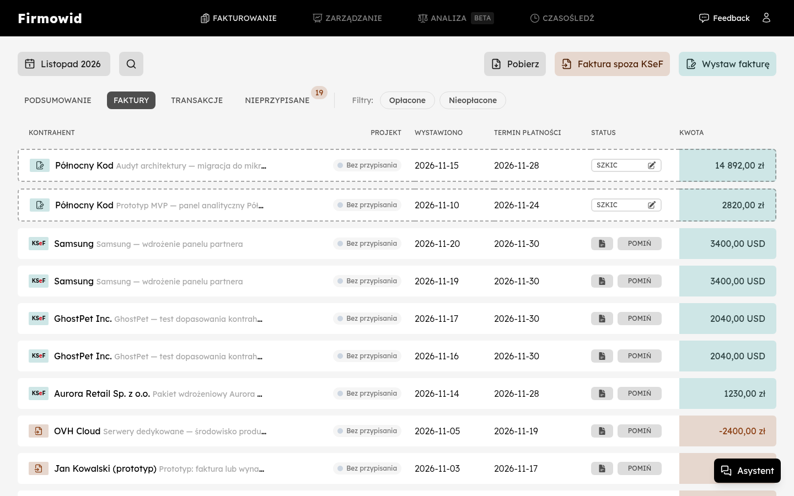
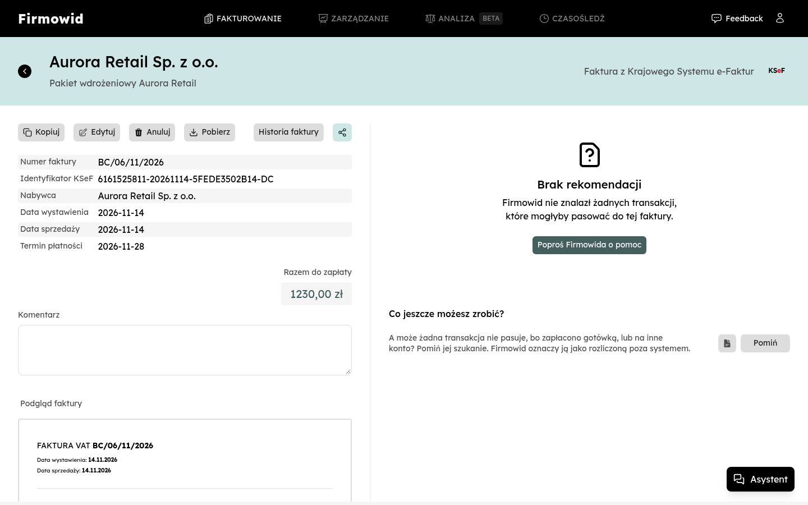
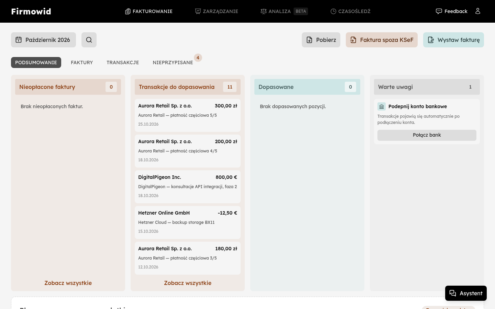
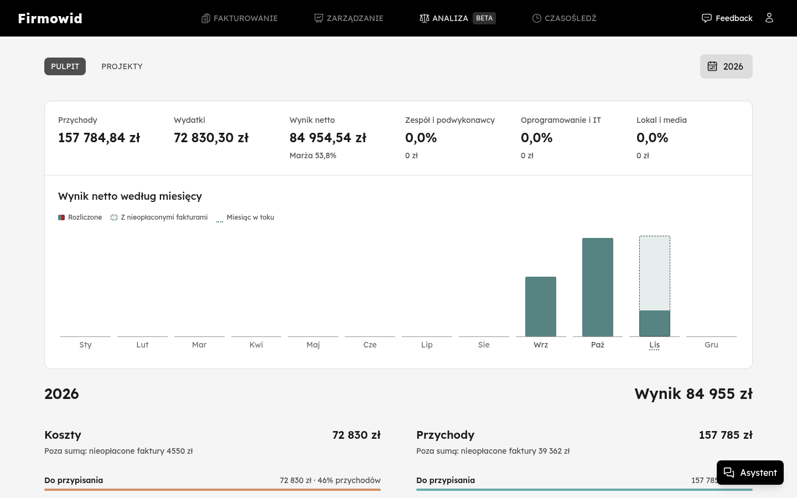
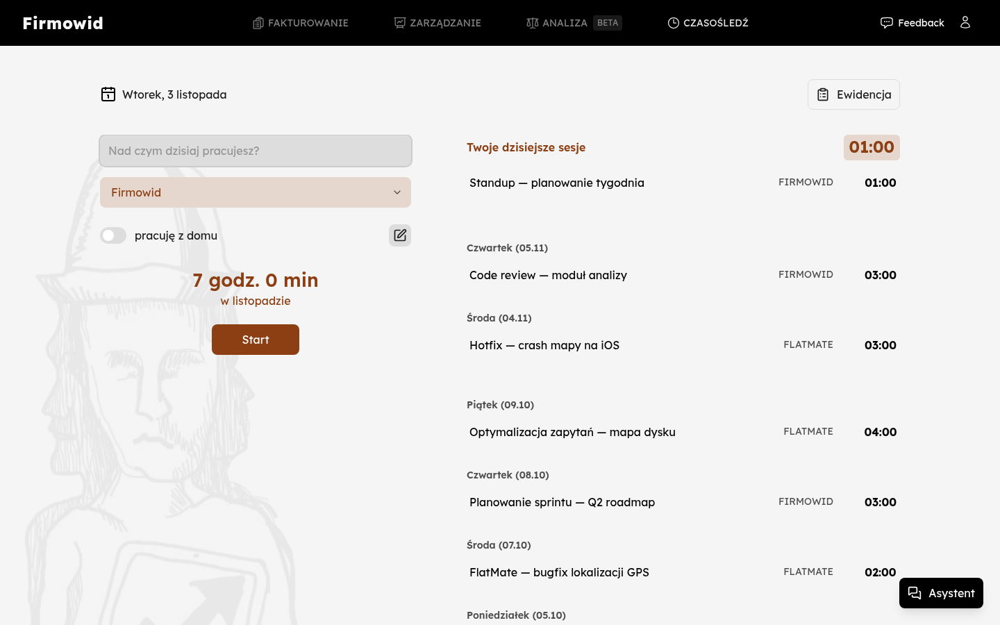

<p align="center">
  
</p>

<h1 align="center">Firmowid</h1>

<p align="center">
  <strong>Faktury z KSeF bez limitu. Za 0 zł.</strong><br>
  KSeF, bank, czas pracy, urlopy i delegacje w jednym miejscu. Open source.
</p>

<p align="center">
  <a href="https://github.com/Alergeek-Ventures/firmowid/actions/workflows/ci.yml?query=branch%3Amain"></a>
  <a href="LICENSE"></a>
  
  
  
</p>

<p align="center">
  <a href="https://firmowid.pl"><strong>firmowid.pl</strong></a> ·
  <a href="#szybki-start-bez-infisical">Szybki start</a> ·
  <a href="#chcesz-pomóc">Jak pomóc</a> ·
  <a href="https://github.com/Alergeek-Ventures/firmowid/discussions">Dyskusje</a>
</p>

<p align="center">
  
</p>

Firmowid to aplikacja dla małych firm w Polsce: faktury w KSeF (wystawianie i
pobieranie), automatyczne parowanie przelewów z bankiem (Open Banking),
ewidencja czasu pracy w projektach, urlopy, delegacje i płace.

Kod jest na licencji [AGPL-3.0](LICENSE). Możesz uruchomić Firmowid na własnym
serwerze albo korzystać z wersji hostowanej na [firmowid.pl](https://firmowid.pl)
(plan Darmowy 0 zł, bez limitu faktur).

> **Note for English speakers:** Firmowid is a web app for small Polish businesses: KSeF e-invoicing, automatic bank-to-invoice matching, time tracking, leave and payroll. Open source under AGPL-3.0. The product targets the Polish market, so this README is in Polish; the commands in [Szybki start](#szybki-start-bez-infisical) work as-is, and `env.template` documents the local configuration in English.

## Co potrafi

<table>
  <tr>
    <td width="50%" valign="top">
      <strong>Faktury i KSeF</strong><br>
      Wystawianie faktur i automatyczne pobieranie kosztowych z Krajowego Systemu e-Faktur, z podglądem PDF.<br><br>
      
    </td>
    <td width="50%" valign="top">
      <strong>Bank i rozliczenia</strong><br>
      Przelewy z Open Bankingu parowane z fakturami: widać, co jest opłacone, a co czeka na dopasowanie.<br><br>
      
    </td>
  </tr>
  <tr>
    <td width="50%" valign="top">
      <strong>Analiza</strong><br>
      Przychody, koszty i wynik netto miesiąc po miesiącu, także w podziale na projekty.<br><br>
      
    </td>
    <td width="50%" valign="top">
      <strong>Czas pracy i zespół</strong><br>
      Ewidencja czasu w projektach (Czasośledź), urlopy, delegacje i płace pracowników.<br><br>
      
    </td>
  </tr>
</table>

Zrzuty pochodzą z lokalnej instalacji na danych testowych z seedów.

## Chcesz pomóc?

Zapraszamy! Poprawki błędów, usprawnienia UX, dokumentacja i nowe pomysły są mile
widziane. Do pracy nad kodem **nie potrzebujesz dostępu do infrastruktury
Alergeek Ventures**: aplikacja działa lokalnie na danych testowych, a wszystkie
zewnętrzne integracje są opcjonalne.

- Masz pytanie albo pomysł? Załóż [dyskusję](https://github.com/Alergeek-Ventures/firmowid/discussions).
- Widzisz błąd? Otwórz [issue](https://github.com/Alergeek-Ventures/firmowid/issues) z krokami do odtworzenia.
- Chcesz coś zmienić? Zrób fork, branch i pull request do `main`. Przy większej
  zmianie najpierw opisz pomysł w issue lub dyskusji, żeby nie pracować na próżno.
- Podatności bezpieczeństwa zgłaszaj prywatnie, zgodnie z [SECURITY.md](SECURITY.md).

Zanim wyślesz PR, przejrzyj [Jak pracujemy](#jak-pracujemy): uruchom `mix check`
i nazwij commity według Conventional Commits.

Dwie rzeczy wymagają maintainera:

- PR z forka nie dostaje sekretów CI, więc pełne CI (tłumaczenia, build, jakość,
  Docker) nie uruchomi się na nim. Maintainer przeniesie twój commit na branch w
  repozytorium i tam uruchomi CI.
- Nowe i zmienione teksty widoczne w UI (Gettext) muszą mieć tłumaczenia w Accent,
  zanim CI przejdzie. Dostęp do Accent mają maintainerzy, więc napisz w PR, które
  teksty się zmieniły. Szczegóły: [CI: snapshoty tłumaczeń](#ci-snapshoty-tłumaczeń).

### Z czego jest zbudowany

- [Elixir](https://elixir-lang.org/), [Phoenix LiveView](https://hexdocs.pm/phoenix_live_view)
  i [Ash Framework](https://ash-hq.org/)
- PostgreSQL ([ParadeDB](https://www.paradedb.com/)), S3 ([SeaweedFS](https://github.com/seaweedfs/seaweedfs))
  i [Gotenberg](https://gotenberg.dev/) do PDF-ów, uruchamiane lokalnie w kontenerach (`local/compose.yml`)

| Katalog | Zawartość |
| --- | --- |
| `lib/firmowid` | Domena i logika biznesowa (zasoby Ash: faktury, KSeF, finanse, płace…) |
| `lib/firmowid_web` | Interfejs webowy (LiveView), ułożony według funkcji |
| `lib/firmowid_mcp` | Serwer MCP dla asystentów AI |
| `lib/firmowid_ui` | Komponenty UI wspólne dla przeglądarki i MCP |
| `priv/repo/seeds*` | Dane testowe do lokalnego developmentu |

Testy leżą obok kodu, który testują (`*_test.exs` w `lib/`).

## Szybki start (bez Infisical)

Ta ścieżka jest dla wszystkich spoza zespołu Alergeek Ventures. Zespół pobiera
wspólną konfigurację z Infisical ([opis niżej](#zespół-alergeek-ventures-infisical));
tutaj generujesz ją lokalnie.

**Potrzebujesz:** Elixira i Erlanga w wersjach z `.tool-versions`, Node.js 26,
Dockera lub Podmana z `compose` oraz kilku paczek systemowych. Instrukcja jest w
sekcji [Instalacja środowiska](#instalacja-środowiska); na Nixie wystarczy
`direnv allow`.

### 1. Pobierz kod

```bash
git clone https://github.com/Alergeek-Ventures/firmowid.git
cd firmowid
```

(albo sklonuj swój fork).

### 2. Skonfiguruj lokalne zmienne

```bash
cp env.template .env.worktree
echo "SECRET_KEY_BASE=$(openssl rand -base64 48)" >> .env.worktree
echo "OAUTH2_SIGNING_SECRET=$(openssl rand -base64 48)" >> .env.worktree
echo "CLOAK_VAULT_KEY=$(openssl rand -base64 32)" >> .env.worktree
```

Klucze są generowane tylko dla twojej lokalnej bazy. `.env.worktree` jest w
`.gitignore`, więc nie trafi do repozytorium.

Następnie wyłącz Infisical w powłoce, w której uruchamiasz polecenia `mix`
(najwygodniej dopisz to do profilu powłoki):

```bash
export AV_SKIP_INFISICAL=1
```

Bez tej flagi aplikacja próbuje pobrać konfigurację z Infisical i kończy się
błędem. Flaga musi być ustawiona w środowisku powłoki; wpis w `.env.worktree` nie
zadziała, bo ten plik jest wczytywany dopiero po kroku Infisical.

### 3. Uruchom bazę danych, S3 i Gotenberga

```bash
docker compose -f local/compose.yml up -d    # albo: podman compose -f local/compose.yml up -d
```

Usługi nasłuchują na portach `5433` (PostgreSQL), `4566` (S3) i `3000`
(Gotenberg). Jeśli któryś jest zajęty, zmień go w `.env.worktree` (dla bazy
ustaw też `DATABASE_URL`) i przekaż te same `DB_PORT`, `S3_PORT`,
`GOTENBERG_PORT` do polecenia `compose`.

### 4. Zainstaluj zależności i przygotuj bazę

```bash
mix setup
```

`mix setup` pobiera zależności Elixira i npm, opublikowany katalog tłumaczeń
(bez klucza Accent), tworzy bazę, uruchamia migracje, seeduje dane testowe i
buduje assety. Pierwsze uruchomienie kompiluje całą aplikację i trwa kilka minut.

Tłumaczenia są pobierane dla bieżącego commita albo `origin/main`. W forku trzymaj
`main` zsynchronizowany z upstreamem, żeby taki snapshot istniał.

### 5. Włącz serwer

```bash
mix phx.server
```

Wejdź na [`localhost:4000`](http://localhost:4000), zaloguj się jako
`kinga@biurocyfrowe.pl` / `kolejka123456` i otwórz
[`/development`](http://localhost:4000/development): znajdziesz tam pełny
przewodnik po danych testowych, kontrahentach, projektach i scenariuszach KSeF.
Wysłane maile zobaczysz w [`/mailbox`](http://localhost:4000/mailbox).

### Co działa bez kluczy zewnętrznych

Większość aplikacji działa na danych testowych bez żadnych kluczy: PDF-y
generuje lokalny Gotenberg, maile trafiają do lokalnej skrzynki, OCR dokumentów
(Reducto) zwraca przykładowe dane z lokalnego mocka, a kursy walut są stałe. Bez
kluczy API nie zadziałają: wzbogacanie faktur przez AI (OpenAI), synchronizacja
z bankiem (GoCardless) i logowanie przez Google. Klucze możesz dopisać do `.env.worktree`; ich lista jest w
`env.template` i w sekcji [Zmienne środowiskowe](#zmienne-środowiskowe).

### Testy i weryfikacja

```bash
mix test               # testy (używa tej samej bazy z compose)
mix check              # weryfikacja przed wypchnięciem
```

Pamiętaj o `AV_SKIP_INFISICAL=1` także przy tych poleceniach. Więcej w
[Weryfikacja zmian](#weryfikacja-zmian).

## Zespół Alergeek Ventures (Infisical)

W zespole wspólne wartości dla środowiska deweloperskiego (klucze, porty, dostęp
do zewnętrznych API) są pobierane z Infisical (`dev`), a `.env.worktree` służy
tylko do lokalnych/worktree-specific nadpisań. Nie ustawiaj `AV_SKIP_INFISICAL`.

1. Zainstaluj Infisical CLI zgodnie z [instrukcją dla swojego systemu](https://infisical.com/docs/cli/overview)
   (w devenv jest dostępne automatycznie).
2. Zaloguj się jednorazowo: `infisical login --domain="https://infisical.alergeek.me"`.
3. Uruchom bazę: `docker compose -f local/compose.yml up -d` (lub `podman compose`).
4. W głównym folderze: `mix setup`, potem `mix phx.server` i wejdź na
   [`localhost:4000`](http://localhost:4000).

Przy pracy w wielu worktree (także z agentami AI) użyj `mix dev.up`; opis jest w
sekcji [Worktree Development](#worktree-development-dla-równoległych-agentów-ai).
Szczegóły ładowania konfiguracji są w [Zmienne środowiskowe](#zmienne-środowiskowe).

## Instalacja środowiska

Wersje Erlanga, Elixira i Node.js są przypięte w `.tool-versions`. Do zarządzania
nimi używamy [asdf](https://asdf-vm.com/guide/getting-started.html). Do usług
lokalnych potrzebujesz też [Dockera](https://docs.docker.com/get-started/get-docker/)
albo [Podmana](https://podman.io/docs/installation) z obsługą `compose`.

### MacOS, Linux, Windows

ℹ️ **Note**: W przypadku Windowsa najlepiej będzie użyć **WSL** ponieważ instalacja niektórych paczek może być problematyczna.

### 1. Zainstaluj [asdf](https://asdf-vm.com/guide/getting-started.html)

### 2. Zainstaluj [erlang](https://github.com/asdf-vm/asdf-erlang) (OTP) za pomocą asdf
  
 **Najpierw** zainstaluj dependencies zgodnie ze swoim OS (instrukcja w [README](https://github.com/asdf-vm/asdf-erlang))

  Następnie:

  ```bash
  asdf plugin add erlang https://github.com/asdf-vm/asdf-erlang.git
  asdf install erlang
  export PATH="${ASDF_DATA_DIR:-$HOME/.asdf}/shims:$PATH"
  ```

### 3. Zainstaluj [elixir](https://github.com/asdf-vm/asdf-elixir.git) za pomocą asdf

```bash
sudo apt install unzip
asdf plugin add elixir https://github.com/asdf-vm/asdf-elixir.git
asdf install elixir
```

### 4. Zainstaluj [Node.js](https://github.com/asdf-vm/asdf-nodejs) za pomocą asdf

```bash
asdf plugin add nodejs https://github.com/asdf-vm/asdf-nodejs.git
asdf install nodejs
```

### 5. Zainstaluj paczki systemowe

`xsltproc` i `qpdf` są potrzebne do generowania PDF-ów faktur.

```
sudo apt-get install -y build-essential git libstdc++6 openssl libncurses6 locales ca-certificates libvips xsltproc qpdf
```

### Nix/NixOS: devenv i direnv

Na Linuxie można zamiast ręcznej instalacji użyć [devenv](https://devenv.sh/)
oraz [direnv](https://direnv.net/). Po zainstalowaniu obu narzędzi zaakceptuj
środowisko poleceniem `direnv allow` (albo uruchom `devenv shell`). Środowisko
zostanie opisane w `devenv.nix` i aktywowane automatycznie po wejściu do katalogu
projektu. Menedżerem zależności JavaScript nadal jest npm (`npm ci --prefix assets`).

CLI Accent jest dostarczany automatycznie przez środowisko devenv. Weryfikację
instalacji można wykonać poleceniem:

```bash
accent --version
```

Pobieranie tłumaczeń uruchamiaj przez `mix translations.fetch`. Eksport aktualnego
katalogu (`--latest`) wymaga klucza `ACCENT_API_KEY` z uprawnieniami odczytu,
dostępnego przez istniejącą konfigurację Infisical; klucza nie umieszczaj w plikach
repozytorium.

Eksportowany katalog PO zawiera tylko wpisy używane przez bieżący POT.
Historyczne tłumaczenia pozostają w Accent; brakujące tłumaczenia, konteksty,
formy liczby mnogiej i placeholdery nadal są weryfikowane bez wyjątków.

## Jak pracujemy

Krótko: małe, skupione PR-y, testy tylko dla krytycznych ścieżek (pieniądze,
faktury i KSeF, autoryzacja, integralność danych), zielony `mix check` i
Conventional Commits. Więcej zasad (także dla agentów AI) jest w
[AGENTS.md](AGENTS.md).

### Weryfikacja zmian

| Polecenie | Kiedy używać |
| --- | --- |
| `mix test lib/ścieżka/do/feature_test.exs` | Do sprawdzenia konkretnej zmiany lub regresji. |
| `mix check` | Przed wypchnięciem: kompilacja, formatowanie i Credo zmienionych plików, katalogi tłumaczeń i wszystkie testy. |
| `mix check --no-test` | Gdy testy są uruchamiane i weryfikowane osobno, np. w CI. |
| `mix check --external` | Świadome włączenie testów korzystających z prawdziwych zewnętrznych API; wymaga dostępnych usług i danych dostępowych. |

Domyślnie testy z oznaczeniem `:external` są pomijane. Weryfikacja nie formatuje
plików automatycznie. Każdy wykonany krok pokazuje czas; błędy mają pełny wynik
polecenia, a pominięte kroki są wyraźnie oznaczone. `--verbose` pokazuje również
wynik poprawnie zakończonych kroków.

Dialyzer, ekstrakcja tłumaczeń, Sobelow, tokeny designu, audyty zależności oraz
formatowanie i Credo całego drzewa działają tylko w CI, które jest ostateczną
bramką.

### Konwencja commitów (Conventional Commits, Angular)

W tym repozytorium wymagamy formatu **Conventional Commits (wariant Angular)**.

Format:

`<type>(<scope>): <subject>`

- `scope` jest **opcjonalny**
- subject piszemy krótko, w trybie rozkazującym, bez kropki na końcu

Przykłady poprawnych commitów:

- `feat(invoicing): add KSeF status badge`
- `fix: handle missing exchange rate on invoice import`
- `chore(ci): add commit message lint workflow`

Przykłady niepoprawnych commitów:

- `Update stuff`
- `fixed bug`
- `Merge branch 'main' into feature/x`

### Walidacja commitów w CI

Commit messages są walidowane w GitHub Actions zgodnie z konfiguracją `@commitlint/config-conventional` (bez lokalnej konfiguracji w repo).

- dla `push`: sprawdzany jest ostatni commit
- dla `pull_request`: sprawdzany jest cały zakres commitów PR (`base..head`)
- merge commit-y są blokowane w CI

Jeśli CI odrzuci commit, popraw wiadomość (`git commit --amend`) albo przepisz historię gałęzi przed ponownym push.

### Polityka migracji (Ash/AshPostgres)

Migracje schematu bazy danych muszą być zarządzane przez narzędzia Ash/AshPostgres.

- Używaj workflow Ash: `mix ash.codegen`, `mix ash.migrate`
  (oraz bazowego `mix ash_postgres.generate_migrations`).
- Nie twórz bezpośrednich migracji Ecto (`mix ecto.gen.migration`) w normalnej pracy.
- Ręczne/bezpośrednie migracje Ecto są dopuszczalne tylko awaryjnie, gdy Ash nie jest
  w stanie wyrazić zmiany na czas.
- Każda taka migracja awaryjna musi być opisana w PR/commicie: powód i plan powrotu
  do migracji zarządzanych przez Ash.

### Konwencje architektury frontendu (`lib/firmowid_web`)

- Ścieżka pliku musi odpowiadać namespace modułu
  (`FirmowidWeb.X.Y.Z` ↔ `lib/firmowid_web/x/y/z.ex`).
- Preferowany układ to **feature-first** z podfolderami: `views/`,
  `components/`, `controllers/`, `utilities/`.
- Zachowujemy kierunkowe zależności: moduły dzieci mogą zależeć od wspólnych
  modułów rodzica, unikamy zależności między rodzeństwem funkcjonalnym.
- Każdą większą zmianę struktury kończymy pełną walidacją: `mix check`.
- Kolory, rozmiary tekstu i promienie zaokrągleń zmieniamy we frontmatterze
  `DESIGN.md`, potem `mix design.tokens` generuje
  `assets/css/design-tokens.css` (CI pilnuje zgodności). Fonty,
  odstępy i animacje są w `assets/css/theme.css`.

### Skille agentów

Własne skille projektu leżą w `.agents/skills` (Codex i OpenCode). Claude Code
czyta tylko `.claude/skills`, dlatego każdy z nich ma tam symlink; po dodaniu
nowego skilla uruchom `ln -s ../../.agents/skills/<nazwa> .claude/skills/<nazwa>`.

#### Impeccable (skill UI)

[Impeccable](https://github.com/pbakaus/impeccable) jest zainstalowany tak, jak
zaleca jego instalator: osobny build na narzędzie w
`.claude/skills/impeccable` (+ subagenty w `.claude/agents/impeccable-*.md`),
`.agents/skills/impeccable` (Codex) i `.opencode/skills/impeccable`
(+ `.opencode/commands/impeccable.md`). Buildy różnią się instrukcjami pod dane
narzędzie, więc nie linkujemy ich między sobą. Wersję przypina paczka npm
`impeccable` w `assets/`. Launcher skilla przy pierwszym użyciu pobiera
pasujący silnik do `~/.impeccable/bin/<wersja>/` i weryfikuje jego sumę
SHA-256; katalogi `scripts/bin/` są w `.gitignore`, tak jak u twórców.
Telemetria i sprawdzanie aktualizacji są wyłączone w `.impeccable/config.json`.

- Skan statyczny: `.agents/skills/impeccable/scripts/impeccable detect lib/firmowid_web/<feature>`
  (pliki `.ex` sprawdza tylko regexami).
- Skan działającej aplikacji wymaga Chromium (`IMPECCABLE_BROWSER=<ścieżka>`)
  i obejmuje tylko strony bez logowania:
  `.agents/skills/impeccable/scripts/impeccable detect http://localhost:<port>/`.
- Aktualizacja: podnieś wersję w `assets/package.json`, uruchom
  `npm install --prefix assets`, potem
  `assets/node_modules/.bin/impeccable install --providers=claude,codex,opencode --scope=project --no-hooks -y --force`.
  Instalator kopiuje silnik do `scripts/bin/` każdego skilla; usuń te kopie
  (`rm -rf .claude/skills/impeccable/scripts/bin .agents/skills/impeccable/scripts/bin .opencode/skills/impeccable/scripts/bin`),
  bo `mix usage_rules.sync` wczytuje wszystkie pliki z `.claude/skills`.

## Zmienne środowiskowe

W środowiskach `dev` i `test` `config/runtime.exs` (przez `Firmowid.Config.LocalEnv`) pobiera wspólne wartości z Infisical `dev` ze ścieżki `/app`, a następnie nakłada lokalne nadpisania z `.env.worktree`. Z flagą `AV_SKIP_INFISICAL=1` krok Infisical jest pomijany i cała konfiguracja pochodzi z `.env.worktree` (zob. [Szybki start](#szybki-start-bez-infisical)).

Jednorazowe logowanie do Infisical:

```bash
infisical login --domain="https://infisical.alergeek.me"
```

Lokalny plik nadpisań:

```bash
touch .env.worktree
```

Uruchamiaj zwykłe komendy Mix, bez wrapperów:

```bash
mix setup
mix dev.up
mix phx.server
mix test
mix check
```

`.env.worktree` wygrywa z wartościami z Infisical i jest przeznaczony na lokalne porty, nazwy baz, tymczasowe flagi lub inne worktree-specific ustawienia. Długoterminowe osobiste nadpisania najlepiej trzymać w Infisical jako personal overrides na ścieżce `/app`.

W zespole awaryjnie lub offline można pominąć pobieranie z Infisical; wtedy aplikacja potrzebuje wymaganych zmiennych w `.env.worktree`:

```bash
AV_SKIP_INFISICAL=1 mix phx.server
```

### Wymagane

- `DATABASE_URL` - string połączenia do PostgreSQL (w `dev` domyślnie baza z `local/compose.yml`)
- `SECRET_KEY_BASE` - klucz tajny Phoenix (wygeneruj przez `mix phx.gen.secret` lub `openssl rand -base64 48`)
- `CLOAK_VAULT_KEY` - klucz szyfrowania danych w bazie, 32 bajty w Base64 (`openssl rand -base64 32`)
- `OAUTH2_SIGNING_SECRET` - sekret podpisywania tokenów OAuth2 dla MCP
- `MCP_RESOURCE_URL` - adres zasobu MCP, np. `http://localhost:4000/mcp`
- `KSEF_ENV` - środowisko KSeF: `test` (lokalnie i staging) albo `prod`
- `PHX_URL` - publiczny adres aplikacji, np. `https://firmowid.pl` (w worktree ustawia go `mix dev.up`)

### S3 Object Storage

Domyślnie skonfigurowane dla localstack w środowisku deweloperskim.

- `S3_HOST` - host endpointu S3 (domyślnie: `localhost`)
- `S3_SCHEME` - schemat URL (domyślnie: `http://`)
- `S3_PORT` - port S3 (domyślnie: `4566`)
- `AWS_ACCESS_KEY_ID` - klucz dostępu AWS
- `AWS_SECRET_ACCESS_KEY` - tajny klucz AWS

**Produkcja:** Skonfiguruj te zmienne aby wskazywały na twoje S3-kompatybilne storage (AWS S3, Tigris, MinIO, itp.)

### Opcjonalne serwisy

Wszystkie zewnętrzne serwisy są opcjonalne. Aplikacja będzie działać bez nich, choć niektóre funkcje będą wyłączone.

#### Analityka i monitoring

Śledzenie błędów jest obsługiwane przez Sentry.
Analityka i flagi funkcjonalności są obsługiwane przez PostHog.

#### Kursy walut

- `OPEN_EXCHANGE_RATES_APP_ID` - klucz API Open Exchange Rates, wymagany na produkcji: bez kursów przeliczenie walut kończy się błędem (dev i testy używają stałych kursów)

#### Integracja bankowa

- `GO_LIMITLESS_SECRET_ID` - GoCardless API secret ID
- `GO_LIMITLESS_SECRET_KEY` - GoCardless API secret key

#### Usługi AI

- `OPENAI_API_KEY` - klucz API OpenAI do wzbogacania faktur
- `REDUCTO_API_KEY` - klucz API Reducto do OCR dokumentów

#### Email

- `RESEND_API_KEY` - klucz API Resend do emaili transakcyjnych

**Development:** Email używa lokalnego adaptera domyślnie, nie wymaga klucza API.

### Zmienne tylko dla produkcji

- `PHX_SERVER` - ustaw na `true` aby uruchomić serwer
- `PORT` - port HTTP (domyślnie: 4000)
- `POOL_SIZE` - rozmiar puli połączeń do bazy danych (domyślnie: 5)

## Worktree Development (dla równoległych agentów AI)

Projekt wspiera izolowane środowiska deweloperskie per branch poprzez git worktrees + worktrunk.

### Wymagania

1. **Worktrunk** - [zainstaluj z crates.io](https://crates.io/crates/worktrunk) lub `cargo install worktrunk`
2. **Caddy** - reverse proxy z admin API

### Konfiguracja Caddy

Caddy musi być uruchomiony z admin API dostępnym pod `localhost/caddy`. Szczegóły konfiguracji zależą od twojego setupu systemowego.

### Użycie

```bash
# Stwórz nowy worktree (automatycznie uruchamia izolowane serwisy)
wt switch --create feature-auth

# Pracuj w worktree
# Phoenix: http://feature-auth.firmowid.localhost
# Tidewave MCP: http://localhost:{PORT}/tidewave/mcp

# Usuń worktree (automatycznie zatrzymuje serwisy)
wt remove feature-auth
```

### Komendy środowiska

- `mix dev.up` - uruchamia usługi deweloperskie.
- `mix dev.down` - zatrzymuje usługi deweloperskie i usuwa ich route z Caddy.
- `mix dev.status` - wyświetla endpointy oraz sprawdza stan Phoenix, Tidewave,
  PostgreSQL, S3, Chromium i LiveDebugger.
- `mix dev.restart` - interaktywnie pozwala wybrać usługi do ponownego
  uruchomienia za pomocą strzałek góra/dół i Spacji (zaznaczanie), a Enter
  zatwierdza wybór. Escape lub `q` anuluje operację. Phoenix obejmuje również
  Tidewave i LiveDebugger. Wybranie PostgreSQL oznacza wybranie i ponowne
  uruchomienie całego środowiska (Phoenix, S3, Chromium i PostgreSQL): wykonuje
  destrukcyjne pełne `mix dev.down` / `mix dev.up` z usunięciem wolumenów i
  wymaga potwierdzenia.

### Jak to działa

1. `wt switch --create` wywołuje hooki z `.config/wt.toml`:
   - kopiuje (reflinkiem) `deps`, `_build`, `assets/node_modules` i pobrane
     locale ze wspólnego cache w `.git/firmowid-build-cache`, a gdy cache jest
     pusty - z głównego checkoutu
   - generuje `.env.worktree` z deterministycznymi portami (hash z nazwy katalogu worktree, stałej po zmianie nazwy brancha)
   - instaluje zależności (`mix deps.get` tylko przy zmianach) i pobiera
     tłumaczenia przed pierwszą kompilacją
   - `mix dev.up` - uruchamia Compose, kompiluje, migruje i seeduje bazę (`mix dev.setup`), rejestruje route w Caddy
   - publikuje świeże zależności i buildy zależności do cache dla kolejnego
     worktree (tylko z historii `origin/main`; build samej aplikacji jest
     pomijany, bo Elixir i tak kompiluje projekt od nowa po zmianie katalogu)

   `mix dev.up` nie pobiera zależności ani tłumaczeń; po zmianie `mix.lock`,
   `package-lock.json` lub tłumaczeń uruchom `mix setup` albo
   `mix translations.fetch`. Lokalny Postgres działa bez `fsync`, bo baza jest
   jednorazowa.

   Hooki są idempotentne. Worktree utworzony bez `wt` (np. przez T3 Code)
   konfiguruje się poleceniem `wt hook pre-start --yes`.

2. Każdy worktree dostaje izolowane:
   - Postgres container z osobnym portem
   - Localstack (S3) container z osobnym portem  
   - Chromium container z osobnym portem
   - Caddy route: `{branch}.firmowid.localhost` → `localhost:{port}`

3. `wt remove` wywołuje `mix dev.down` - zatrzymuje kontenery i usuwa route z Caddy

## Dla maintainerów

Szczegóły CI, cache i aktualizacji zależności. Nie są potrzebne do pracy nad
kodem aplikacji.

### CI: kompilacja i ekstrakcja Gettext

Quality i Build/Test korzystają ze wspólnego cache kompilacji oraz tych samych
portów PostgreSQL i S3, ustawianych przez `.github/actions/elixir-setup`.
Różna konfiguracja tych usług wymuszałaby rekompilację całej aplikacji.

Gettext 1.0 wymusza kompilację również przy `--check-up-to-date`. CI zachowuje
tę kontrolę, ale zapamiętuje jej udany wynik dla dokładnego drzewa Git i wersji
OTP/Elixir. Drzewo obejmuje zarówno treść, jak i ścieżki plików, więc zmiana
źródeł, numerów linii, nazw plików, POT, konfiguracji lub zależności wymusza
ponowną kontrolę. Cache nie przechowuje ani nie nadpisuje POT. Pozostałe kontrole
działają normalnie. Lokalne uruchomienie również zapamiętuje udaną kontrolę;
`mix translations.extract.check --force` wymusza jej ponowne wykonanie.

#### CI: snapshoty tłumaczeń

Każdy przebieg CI (PR i `main`) eksportuje aktualny katalog z Accent przez
`elixir scripts/accent.exs snapshot --version FULL_SHA`. Skrypt rzutuje go na
bieżący POT, waliduje każdy tłumaczony język (`pl`, `uk`: brakujące tłumaczenia,
konteksty, formy liczby mnogiej, placeholdery) i oznacza pliki PO znacznikiem
`# Accent version: FULL_SHA` commita. Joby testów, jakości i Dockera pobierają ten
katalog jako artefakt i sprawdzają znacznik. Nowe i zmienione teksty muszą więc mieć
tłumaczenia w Accent, zanim CI PR-a przejdzie.

Po eksporcie na `main` job `Publish translation snapshot` publikuje zwalidowany
katalog jako niezmienny plik `FULL_SHA.tar.gz` w wydaniu GitHub
`translation-snapshots`. Build wdrożeniowy (`deployment/Containerfile.app`) instaluje
ten snapshot przez `elixir scripts/accent.exs export --version FULL_SHA`, więc
produkcja dostaje dokładnie katalog zwalidowany dla swojego commita. Ponowne
uruchomienie CI dla commita `main` używa już opublikowanego snapshotu. Nie
tworzymy wersji w Accent.

Ten sam job podpisuje proweniencję snapshotu przez `actions/attest` (Sigstore) i
publikuje bundle obok niego jako `FULL_SHA.tar.gz.intoto.jsonl`. Awaria Sigstore
nie blokuje wdrożenia: snapshot trafia wtedy do wydania bez podpisu. Wydanie trzyma
400 najnowszych snapshotów, bo GitHub mieści najwyżej 1000 plików w jednym wydaniu.
Pochodzenie pobranego snapshotu sprawdzisz tak:

```bash
gh attestation verify FULL_SHA.tar.gz --repo Alergeek-Ventures/firmowid
```

Lokalnie:

```bash
mix translations.fetch --latest                                  # aktualny katalog z Accent (wymaga ACCENT_API_KEY)
mix translations.fetch --version FULL_SHA --fallback-version MAIN_FULL_SHA  # opublikowany snapshot
```

Lokalny `mix setup` i hook worktree instalują snapshot `HEAD`, a przy jego braku
snapshot `origin/main`. Przed setupem wykonaj `git fetch origin main`, jeśli ta
lokalna referencja ma wskazywać aktualny `main`. Katalog jest kompilowany podczas
builda; aplikacja nie wywołuje Accent w runtime.

CI wymaga tylko sekretu `ACCENT_API_KEY` z uprawnieniami odczytu/eksportu.
GitHub Actions i Dependabot mają osobne tokeny projektu. Przebiegi Dependabota na
`main` nie publikują snapshotu (ich token nie może tworzyć wydań, także przy
ponowieniu), więc build wdrożeniowy takiego commita nie znajdzie katalogu; aplikację
wdroży następny commit na `main`.

Sekrety CI utrzymujemy w Infisicalu.

### CI: cache obrazów Dockera

`Docker Build Check` działa na standardowych runnerach GitHub-hosted i używa Buildx
`gha` cache o zakresie `firmowid-app`, w trybie `max`, obejmującym również
pośrednie warstwy zależności. Kosztowne `mix deps.compile` jest wykonywane przed
kopiowaniem źródeł npm i assetów; `npm ci` zależy tylko od manifestów. Pełne
źródła assetów są kopiowane po `mix compile`, przed budowaniem assetów.

Eksport cache jest opcjonalny (`ignore-error`): błędy eksportu nie przerywają
jobu, ale błędy samego builda nadal są fatalne. Cache jest izolowany między
branchami: `main` nie może odtworzyć cache utworzonego wyłącznie dla PR-a, choć
PR może korzystać z cache `main`. Pierwszy build `main` po merge może więc być
zimny.

Zmierzony przypadek dla PR #38 — ten sam SHA i artefakt, drugi przebieg:

| Przebieg | Czas jobu |
|---|---:|
| Zimny | 6:21 |
| Ciepły | 0:33 |

[Pierwszy przebieg](https://github.com/Alergeek-Ventures/firmowid/actions/runs/37020260453/job/110881514104)
(build 5:53, eksport cache 79,2 s) i
[drugi przebieg](https://github.com/Alergeek-Ventures/firmowid/actions/runs/37020260453/job/110884360739)
(build 0:07, eksport 3,3 s) pokazują najlepszy przypadek ponowienia dla
niezmienionego SHA, a nie typowy czas po zmianie źródeł. Zmiana
`SOURCE_COMMIT` lub znacznika wygenerowanego `default.po` może unieważnić warstwy
tłumaczeń i aplikacji mimo niezmienionych zależności. Nie zakładamy, że pierwszy
build `main` po merge będzie miał ciepły cache.

[Raport pięciu scenariuszy benchmarku](DOCKER_CACHE_BENCHMARK.md) porównuje
oryginalny build, samo przełożenie warstw i cache `gha` na świeżych runnerach.
W przypadkach zmian źródeł cache zależności skrócił joby, ale invalidacja
manifestu Mix była z cache wolniejsza. To pomiary syntetycznych zmian przy
zmieniającym się SHA i katalogu PO, bliższe codziennemu CI niż ponowienie tego
samego SHA; nie stanowią gwarancji czasu kolejnych buildów.

### Zarządzanie zależnościami

#### Automatyczne (Dependabot)

Dependabot otwiera PR-y w każdy poniedziałek o 06:00 czasu warszawskiego. Śledzi:

- **Paczki Elixir** — `mix.exs` / `mix.lock`
- **Obrazy kontenerów** — `deployment/Containerfile.*` (app, seaweedfs, gotenberg)
- **Obrazy w Compose** — `local/compose.yml` (paradedb, seaweedfs)
- **GitHub Actions** — wersje akcji w `.github/workflows/`

#### Ręczne (deweloperzy)

Te wersje są przypięte w plikach, których Dependabot nie obsługuje.
Sprawdzaj je **co tydzień** przy okazji przeglądania PR-ów Dependabota:

| Co | Gdzie | Gdzie sprawdzić |
|----|-------|-----------------|
| Elixir | `.tool-versions` | <https://github.com/elixir-lang/elixir/releases> |
| Erlang/OTP | `.tool-versions` | <https://github.com/erlang/otp/releases> |
| Tailwind CSS CLI i core | `assets/package.json` (`@tailwindcss/cli`, `tailwindcss`) oraz `config/config.exs` (`:tailwind, version:`) | <https://github.com/tailwindlabs/tailwindcss/releases> |
| esbuild | `config/config.exs` (`:esbuild, version:`) | <https://github.com/evanw/esbuild/releases> |

> **Prompt dla agenta do cotygodniowego sprawdzenia:**
>
> ```
> Check for new stable releases of Elixir, Erlang/OTP, Tailwind CSS,
> and esbuild. Only consider releases that are at least 7 days old
> (supply chain attack mitigation). Compare with versions pinned in
> .tool-versions, assets/package.json, and config/config.exs. Keep the Tailwind
> CLI and core versions synchronized; if any are outdated, bump them
> and run mix check. For Elixir/Erlang, also update the hexpm/elixir
> image tag in deployment/Containerfile.app to match.
> ```
